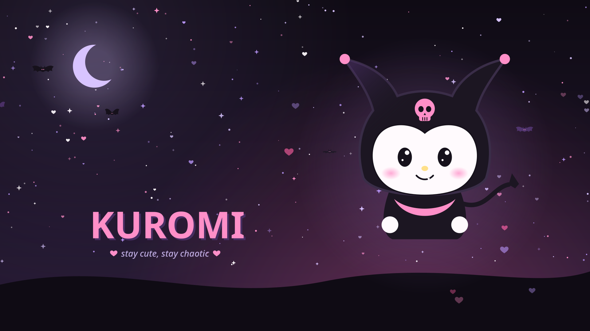
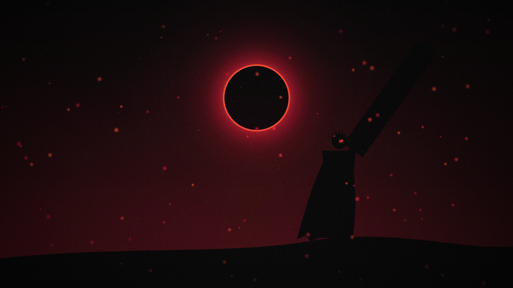

# dotfiles: CachyOS + Hyprland + Noctalia

Setup com **temas completos** no estilo do [HyDE](https://github.com/HyDE-Project/HyDE). Cada tema traz
paleta, bordas do Hyprland, fonte e estilo do kitty, fastfetch, seletores e os próprios wallpapers.

| Tema | | |
|---|---|---|
| **Kuromi** ♥ | preto do capuz, rosa da caveira, roxo lavanda |  |
| **Guts** ⚔ | preto da armadura, vermelho do eclipse, cinza do aço (Berserk) |  |

## Estrutura

```
dotfiles/
├── install.sh                  # pacotes, backup, symlinks e tema inicial
├── config/                     # cada pasta vira ~/.config/<nome>; leem do tema ativo
│   ├── hypr/                   # config/colors.lua carrega themes/current/hypr.lua
│   ├── noctalia/               # config.toml + palettes/<Tema>.json (links)
│   ├── kitty/                  # kitty.conf inclui theme.conf → themes/current/kitty.conf
│   ├── fastfetch/              # config.jsonc → themes/current/fastfetch.jsonc
│   ├── rofi/                   # wallselect.rasi (layout HyDE) + theme.rasi → tema ativo
│   └── fish/
├── themes/
│   ├── current -> Kuromi       # tema ativo (link local, trocado pelo ktheme)
│   ├── Kuromi/
│   └── Guts/
│       ├── theme.conf          # nome, descrição, modo, wallpaper padrão, ícone, cor de destaque
│       ├── palette.json        # paleta do Noctalia → barra, kitty, GTK, Qt, btop
│       ├── hypr.lua            # bordas, cantos, gaps, blur, sombra (tabela THEME)
│       ├── kitty.conf          # fonte, opacidade, cursor, abas
│       ├── fastfetch.jsonc     # + logo.png
│       ├── rofi.rasi           # cores e título dos seletores
│       ├── downloads.txt       # wallpapers animados extras (baixados, fora do git)
│       └── wallpapers/         # wallpapers originais do tema (png / mp4)
├── scripts/
│   ├── ktheme                  # troca de tema
│   └── kwall                   # troca de wallpaper (só os do tema ativo)
└── tools/                      # geradores de arte (Cairo): kuromi_art.py, guts_art.py
```

## Instalação

```bash
git clone https://github.com/<seu-usuario>/dotfiles ~/dotfiles
cd ~/dotfiles && ./install.sh
```

Configs antigas vão para `~/.config-backup-<data>/`.

## Atalhos

| Atalho | Ação |
|---|---|
| `SUPER + SHIFT + T` | seletor de temas |
| `SUPER + ALT + T` | próximo tema |
| `SUPER + ALT + W` | seletor de wallpapers do tema (carrossel estilo HyDE) |
| `SUPER + CTRL + W` | wallpaper aleatório do tema |
| `SUPER + SHIFT + ALT + W` | animado aleatório |
| `SUPER + SHIFT + CTRL + W` | parar animação |
| `SUPER + SHIFT + W` | painel de wallpapers do Noctalia |

```bash
ktheme set Guts                      # aplica um tema
kwall set ~/Videos/meu-loop.mp4      # qualquer vídeo/gif vira wallpaper animado
kwall add https://site/imagem.png    # baixa para ~/Imagens/Wallpapers/<Tema>/ e aplica
kwall fetch all                      # baixa os downloads.txt de todos os temas
kwall pause | stop
```

Cada tema lembra o último wallpaper usado. Wallpapers pessoais vão em `~/Imagens/Wallpapers/<Tema>/`.

## Criar um tema novo

1. `cp -r themes/Guts themes/MeuTema` e edite `theme.conf`, `palette.json`, `hypr.lua`, `kitty.conf`, `rofi.rasi` e `fastfetch.jsonc`.
2. Coloque wallpapers em `themes/MeuTema/wallpapers/` ou liste links em `downloads.txt`.
3. `ktheme set MeuTema`

## Wallpapers de terceiros

Os animados listados em `themes/*/downloads.txt` são fan art do [MotionBGs](https://motionbgs.com)
(Kuromi © Sanrio, Berserk © Kentaro Miura / Hakusensha). Por isso não ficam no repositório:
o `install.sh` baixa os vídeos com `kwall fetch all`. Os wallpapers dentro de `themes/*/wallpapers/`
são desenhados por código (`tools/*_art.py`).
